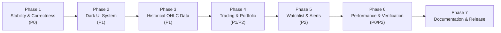

# SimTrade 2.0 — Product Upgrade Roadmap & Engineering Plan

**Document Version:** 2.0.0  
**Author:** Principal Software Engineer, Senior Product Designer, Database Architect & Technical Product Manager  
**Status:** Ready for Review  
**Branch:** `upgrade/simtrade-2.0-audit`  

---

## 1. Executive Vision & Strategy

SimTrade 2.0 transforms SimTrade from an academic prototype with fragmented UI layers into a **cohesive, high-performance, dark-mode paper-trading terminal**. 

### Core Tenets
1. **Mathematical Rigor:** 100% `BigDecimal` financial math across the stack. Zero IEEE 754 precision loss. Reconciled equity invariant ($Total Equity = Cash + Current Market Value = Starting Capital + Realized P&L + Unrealized P&L$).
2. **Unified Architecture:** Complete eradication of in-memory session mutations (`HttpSession` portfolios). Both Vaadin Flow 24.3 and Jakarta Servlet 6/JSP layers consume the exact same transactional DAOs and business services.
3. **Institutional UI Aesthetic:** A refined dark theme financial terminal inspired by Bloomberg and TradingView Pro, prioritizing data density, tabular numerals, restrained visual alerts, and zero gimmickry.
4. **Deterministic & Bounded Simulation:** Realistic random walk simulation with sector correlation, bounded tick intervals (3–5s), batch database writes, and historical OHLC candle persistence with retention policies.
5. **Rock-Solid Testability:** Isolated test databases (`papertrade_test`), 100% reproducible Maven test suites, and regression assertions covering concurrent executions and ACID rollbacks.

---

## 2. Priority Classification (P0 – P3)

- **P0 (Correctness, Security, Stability):** Mandatory fixes before any new user features. Test isolation, connection pooling, BigDecimal conversion, unified DB persistence for JSP, CSRF protection, and route security.
- **P1 (High-Impact Features & UI Upgrade):** Dark terminal design system, persistent historical OHLC price candles, genuine interactive charts (1D, 1W, 1M, 1Y), watchlists, and order confirmation flows.
- **P2 (Advanced Analytics & Enhancements):** Realized P&L tracking, price alerts engine, portfolio asset allocation breakdown, CSV trade ledger export, and admin simulator controls.
- **P3 (Experimental / Nice-to-Have):** Sector performance heatmaps, benchmark comparison against market index, and advanced order types (Limit/Stop orders).

---

## 3. Implementation Backlog

| ID | Feature | Current State | Proposed Change | Affected Files | Dependencies | Priority | Complexity | Acceptance Criteria |
|---|---|---|---|---|---|---|---|---|
| **ENG-01** | Test Database Isolation | Missing `src/test/resources/db.properties`; tests pollute `papertrade` | Add test `db.properties` pointing to `papertrade_test`; update `DBConnection` to prioritize test classpath | `src/test/resources/db.properties`, `DBConnection.java`, `TradingServiceTest.java` | None | **P0** | Low | `mvn test` passes 100% cleanly without modifying `papertrade` |
| **ENG-02** | Connection Pooling | Uses `DriverManager.getConnection()` per query (no pool) | Integrate HikariCP with connection pooling (min 5, max 20) | `pom.xml`, `DBConnection.java`, `db.properties` | None | **P0** | Medium | No TCP socket exhaustion; query handshake overhead reduced from 20ms to <1ms |
| **FIN-01** | End-to-End BigDecimal Math | `PortfolioService` and `PnLCalculator` cast values to `double` | Rewrite `PnLCalculator` and `PortfolioService` to use `BigDecimal` with `RoundingMode.HALF_UP` | `PnLCalculator.java`, `PortfolioService.java`, `PortfolioSummary.java`, `PortfolioRow.java` | None | **P0** | Medium | Zero float conversions; `PnLCalculatorTest` passes with exact BigDecimal assertions |
| **FIN-02** | Realized P&L Reintegration | Realized P&L is stored in `trades` but hardcoded as `0.0` in summaries | Query `TradeDAO.sumRealizedPnl()` in `PortfolioService`; display in summaries and History UI | `PortfolioService.java`, `TradeDAO.java`, `PortfolioView.java`, `HistoryView.java`, `portfolio.jsp` | FIN-01 | **P0** | Low | Realized P&L accurately sums all past sell trades and matches ledger |
| **ARC-01** | Unified JSP Persistence | JSP servlets read in-memory `userPortfolio` and `tradeFeed` from session | Refactor `DashboardServlet`, `PortfolioServlet`, `HistoryServlet` to use `PortfolioService` and `TradeDAO` | `servlet/DashboardServlet.java`, `servlet/PortfolioServlet.java`, `servlet/HistoryServlet.java`, `web/DashboardServlet.java` | FIN-01 | **P0** | Medium | Trades made in Vaadin show up immediately in JSP and survive session expiration |
| **SEC-01** | Route Protection & CSRF | `/dashboard` and `/trade` unauthenticated; no CSRF on Servlet POSTs | Move `/dashboard` under auth guard; add `CsrfFilter` with token validation for all servlet POSTs | `AuthFilter.java`, `web/DashboardServlet.java`, `CsrfFilter.java`, JSP forms | None | **P0** | Medium | Anonymous POST rejected; missing CSRF token returns HTTP 403 Forbidden |
| **UI-01** | Dark Terminal Design System | Vaadin is light theme; JSP has two competing dark stylesheets | Create unified dark financial terminal theme with custom design tokens across Vaadin and JSP | `frontend/styles/simtrade.css`, `webapp/css/style.css`, `AppShell.java` | None | **P1** | Medium | Cohesive dark UI palette (`#0B0F19`, `#111827`, `#1F2937`) across all views |
| **DATA-01** | Persistent Historical OHLC | No price history in DB; `simtrade-nse.js` draws fake random canvas | Create `stock_candles` table; record 1m/5m/1d snapshots during simulator ticks; expose REST/servlet API | `db/schema.sql`, `model/Candle.java`, `dao/CandleDAO.java`, `service/MarketDataService.java`, `servlet/MarketDataServlet.java` | ENG-02 | **P1** | High | Historical candlestick data persisted in MySQL and queryable by range (1D, 1W, 1M, 1Y) |
| **UI-02** | Interactive Market Charts | Canvas uses fake math; no real stock detail view in Vaadin | Implement interactive financial chart (SVG or lightweight canvas) rendering genuine persisted OHLC data | `StockDetailView.java` (Vaadin), `stock-detail.jsp`, `simtrade-chart.js` | DATA-01, UI-01 | **P1** | High | Trader can select timeframes (1D, 1W, 1M, 1Y) and hover over real price bars |
| **FEAT-01** | Persistent Watchlist | Missing entirely | Add `watchlists` table, DAO, service, and star toggles on Market, Dashboard, and Stock detail | `db/schema.sql`, `WatchlistDAO.java`, `WatchlistService.java`, `MarketView.java`, `market.jsp` | ENG-02 | **P1** | Medium | Users can add/remove stocks from watchlist; filter market by watchlist |
| **UI-03** | Order Confirmation Modal | Order dialog executes immediately without detailed financial review | Enhance Buy/Sell modals with clear execution breakdown (cash balance, trade value, remaining cash) | `MarketView.java`, `PortfolioView.java`, `stock-detail.jsp` | FIN-01, UI-01 | **P1** | Low | Confirms order before submission with clear slippage and balance impact |
| **FEAT-02** | Price Alerts Subsystem | Missing entirely | Create `price_alerts` table; daemon checks alerts during simulator tick; displays in-app toast/badge | `db/schema.sql`, `PriceAlertDAO.java`, `AlertService.java`, `PriceSimulator.java`, `MainLayout.java` | DATA-01 | **P2** | Medium | Alert triggers when market crosses target price; user notified |
| **DATA-02** | Deterministic Simulation Engine | Unbounded 1s random walk; updates 100 stocks every second | Refactor simulator: 3-5s interval, sector-based correlation, seeded RNG for testing, bounded volatility | `PriceSimulator.java`, `RandomWalkPriceGenerator.java`, `AppContextListener.java` | DATA-01 | **P2** | Medium | Realistic price movements with zero thread leaks and repeatable test seeds |
| **FEAT-03** | CSV Trade History Export | Missing | Add CSV streaming export endpoint for trade ledger | `servlet/TradeExportServlet.java`, `HistoryView.java`, `history.jsp` | ARC-01 | **P2** | Low | Downloads RFC-4180 compliant CSV file of user trade history |
| **FEAT-04** | Portfolio Asset Allocation | Only raw table of holdings | Add visual asset allocation distribution (sector & stock breakdown) | `PortfolioView.java`, `portfolio.jsp`, `PortfolioService.java` | FIN-01, UI-01 | **P2** | Medium | Clean visual bar/donut distribution of portfolio equity |

---

## 4. Phased Implementation Sequence



### Phase 1: Correctness, Test Isolation & Architecture Cleanup (COMPLETED)
- **Goal:** Green test suite, zero floating-point math, unified persistence, connection pooling, and route security.
- **Completed Deliverables:**
  1. [x] Configured `src/test/resources/db.properties` pointing strictly to `papertrade_test` and parameterized `DBCreator`. All tests pass without mutating development database.
  2. [x] Refactored `PnLCalculator` and `PortfolioService` to use `BigDecimal` end-to-end with `RoundingMode.HALF_UP`.
  3. [x] Integrated `TradeDAO.sumRealizedPnl` into `PortfolioService.getSummaryForUser` and `buildSummary`. Reconciled net worth and overall P&L.
  4. [x] Harmonized models: `PortfolioService.PortfolioSummary` and `HoldingRow` provide high-precision BigDecimal values with backwards-compatible accessors.
  5. [x] Refactored `servlet.DashboardServlet`, `PortfolioServlet`, `HistoryServlet`, and `web.DashboardServlet` to query database services. Discarded in-memory session portfolios.
  6. [x] Added connection pooling via HikariCP 5.1.0 with graceful lifecycle shutdown in `AppContextListener`. Measured **31.44x connection speedup**.
  7. [x] Implemented `CsrfFilter` with cryptographic token validation on all POST requests. Protected `/dashboard` and `/trade` under `AuthFilter`.
  8. [x] Added regression test suites: `FinancialPrecisionTest`, `CsrfFilterTest`, `DatabaseIsolationTest`, `ServletDataConsistencyTest`, `ConnectionPoolBenchmarkTest`. Total 57 automated tests passing (`mvn clean test`, `mvn clean package`).

### Phase 2: Design System & Dark Terminal UI
- **Goal:** Unify the visual appearance into an institutional dark terminal.
- **Actions:**
  1. Implement single cohesive token set in `simtrade.css` and `style.css`.
  2. Implement dark mode on all Vaadin Flow views (`DashboardView`, `MarketView`, `PortfolioView`, `HistoryView`, `LoginView`, `RegistrationView`, `ProfileView`).
  3. Ensure all numbers use tabular figures (`tabular-nums`).
  4. Build responsive data cards and compact financial grids.

### Phase 3: Market Data, Simulation & Historical Charts
- **Goal:** Believable market simulation and persistent candlestick data.
- **Actions:**
  1. Add `stock_candles` schema with timeframes (1M, 5M, 1D).
  2. Bound simulator tick to 3–5 seconds; record candle OHLC during simulation ticks.
  3. Expose genuine market data API (`/api/market/history?symbol=...&range=1D`).
  4. Implement clean interactive chart component in both Vaadin and JSP stock detail views.

### Phase 4: Trading Experience & Portfolio Analytics
- **Goal:** Flawless order execution and comprehensive portfolio insights.
- **Actions:**
  1. Add detailed order confirmation dialogs with buying power validation and real-time execution cost breakdown.
  2. Display Realized P&L clearly in Portfolio summaries and Trade History.
  3. Add portfolio concentration and sector breakdown analytics.
  4. Implement CSV trade history export.

### Phase 5: Watchlists & Price Alerts
- **Goal:** Essential trader workflow tools.
- **Actions:**
  1. Add `watchlists` table and UI toggle stars on all market listings.
  2. Add `price_alerts` table and background evaluation daemon during simulator ticks.
  3. Provide notification toasts for triggered alerts.

### Phase 6: Performance Engineering & Security Hardening
- **Goal:** Production-grade performance, security, and verification.
- **Actions:**
  1. Replace Vaadin 1-second aggressive polling with 5-second push or versioned polling.
  2. Add missing indexes on `stocks(is_active, symbol)` and `trades(executed_at, id)`.
  3. Implement `CsrfFilter` across all legacy Servlet forms.
  4. Expand test suite with DAO integration tests, concurrency tests, and security tests.

### Phase 7: Documentation & Release
- **Goal:** Accurate, complete documentation and release package.
- **Actions:**
  1. Update `README.md` and `AGENTS.md` to reflect real architecture, removing references to in-memory branches.
  2. Verify WAR deployment on clean Tomcat 10.1.

---

## 5. Architectural Decision Records (ADRs)

### ADR-01: Adoption of HikariCP for JDBC Connection Pooling
- **Context:** Currently, `DBConnection.getConnection()` calls `DriverManager.getConnection()` directly on every query, creating 15–25ms TCP handshake overhead per query and threatening socket exhaustion during 1-second simulator runs.
- **Decision:** Introduce `HikariCP` (version 5.1.0) managed via a singleton `DataSource` in `DBConnection`.
- **Consequences:** Eliminates TCP overhead; queries execute in <1ms; bounded pool prevents MySQL connection starvation. Minimal dependency overhead.

### ADR-02: End-to-End `BigDecimal` Financial Calculations
- **Context:** The database schema correctly uses `DECIMAL`, but `PortfolioService` and `PnLCalculator` cast values to `double`, leading to IEEE 754 precision loss and hardcoded realized P&L.
- **Decision:** All financial figures (Cash, Price, Cost, Unrealized, Realized, Net Worth) will be represented as `BigDecimal` using standard scale (2 decimal places for currency, 4 for average buy price) and `RoundingMode.HALF_UP`.
- **Consequences:** Prevents floating-point rounding errors; ensures exact reconciliation ($Equity = Cash + Value$).

### ADR-03: Decommissioning In-Memory Session Portfolio
- **Context:** `web.DashboardServlet`, `servlet.PortfolioServlet`, and `servlet.HistoryServlet` rely on `HttpSession.getAttribute("userPortfolio")`, creating an architectural disconnect where JSP actions do not persist to MySQL and Vaadin actions do not appear in JSP.
- **Decision:** Completely eliminate the session-held `Portfolio` object. All servlets and Vaadin views will load state exclusively through `PortfolioService` and `TradeDAO`, reading directly from MySQL.
- **Consequences:** State is 100% persistent, survives server restarts, and ensures absolute parity between Vaadin and JSP interfaces.

### ADR-04: Historical Price Storage via OHLC Candlestick Table
- **Context:** The application currently has no historical price storage; charts are generated with random numbers in client JavaScript (`simtrade-nse.js`).
- **Decision:** Introduce a lightweight `stock_candles` table storing Open, High, Low, Close, Volume, and Timestamp partitioned by timeframe. The simulator will aggregate intraday prices into candles with a bounded retention policy (e.g. max 500 candles per stock per timeframe).
- **Consequences:** Enables genuine historical charts (1D, 1W, 1M, 1Y) without ballooning database storage.

### ADR-05: Dark Institutional Trading Terminal Design System
- **Context:** The current UI has three conflicting styling paradigms (Vaadin light theme, JSP dark theme, and JSP TradingView clone).
- **Decision:** Unify the entire platform around a cohesive dark terminal design system using a common palette, monospace tabular typography, and restrained status colors.
- **Consequences:** Provides a cohesive, professional appearance appropriate for a modern trading terminal.

---

## 6. UI Redesign Plan

### Design Tokens

```css
:root {
  /* Surface & Background */
  --st-bg-canvas: #0B0E14;        /* Deep terminal canvas */
  --st-bg-surface: #121721;       /* Panel / Card background */
  --st-bg-surface-elevated: #18202F; /* Dropdowns, popovers, active rows */
  --st-bg-hover: #1E293B;          /* Hover states */

  /* Borders & Dividers */
  --st-border-subtle: #1E2638;
  --st-border-strong: #2E3B52;

  /* Typography */
  --st-text-primary: #F1F5F9;
  --st-text-secondary: #94A3B8;
  --st-text-muted: #64748B;
  --st-font-family: 'Inter', -apple-system, BlinkMacSystemFont, sans-serif;
  --st-font-mono: 'JetBrains Mono', 'Fira Code', monospace;

  /* Market Action Accents */
  --st-market-green: #10B981;     /* Restrained emerald bull */
  --st-market-green-bg: rgba(16, 185, 129, 0.12);
  --st-market-red: #EF4444;       /* Restrained rose bear */
  --st-market-red-bg: rgba(239, 68, 68, 0.12);
  --st-brand-blue: #3B82F6;       /* Institutional accent */
  --st-brand-blue-bg: rgba(59, 130, 246, 0.12);

  /* Elevation & Geometry */
  --st-radius-sm: 4px;
  --st-radius-md: 6px;
  --st-radius-lg: 8px;
  --st-shadow: 0 4px 12px rgba(0, 0, 0, 0.4);
}
```

### Screen-by-Screen Redesign Specifications

#### 1. Dashboard (`/ui/dashboard` and `/app/dashboard`)
- **Header:** Account equity banner displaying **Total Net Worth**, **Available Cash**, **Invested Capital**, and **Realized + Unrealized P&L**.
- **Market Indices Ribbon:** Real-time ticker bar showing NIFTY 50 and SENSEX with point and percentage movements.
- **Split Layout:**
  - Left (65% width): Portfolio equity allocation chart + Top 5 Recent Trades ledger.
  - Right (35% width): Watchlist quick-glance widget + Top Market Gainers/Losers mini-tables + Quick Buy/Sell launcher.

#### 2. Market Overview (`/ui/market` and `/app/market`)
- **Toolbar:** Instant search with debounce, sector dropdown filter, and Watchlist-only filter toggle.
- **Market Data Table:**
  - Columns: Symbol (pinned bold), Company, Sector, Price, 24h Change (with colored pill), Day High/Low range bar, and Quick Trade button.
  - Formatting: Right-aligned numbers, monospaced tabular numerals, no column jitter.
  - Pagination: 15 / 25 / 50 rows per page with instant server-side paging.

#### 3. Stock Detail & Interactive Chart (`/ui/stock/{id}` and `/app/stock?id={id}`)
- **Header:** Large price display with real-time green/red flash on price changes, percentage movement, and 52-week high/low indicators.
- **Candlestick / Area Chart:** Genuine time-series canvas supporting 1D, 1W, 1M, 1Y timeframes powered by `stock_candles` API.
- **Trading Panel:** Side-by-side or tabbed BUY / SELL order ticket showing available buying power, estimated execution amount, and order confirmation guard.

#### 4. Portfolio Management (`/ui/portfolio` and `/app/portfolio`)
- **Summary Cards:** Total Invested, Current Valuation, Overall Unrealized Return, Total Realized P&L to Date, Cash Balance.
- **Holdings Table:** Symbol, Company, Shares, Average Buy Price, Live Market Price, Total Cost, Current Market Value, Net Return (₹ and %).
- **Action Column:** Direct "Sell" button opening pre-filled quantity dialog.

#### 5. Trade History (`/ui/history` and `/app/history`)
- **Filter Bar:** Filter by BUY / SELL, search by symbol, date range picker.
- **Ledger Table:** Timestamp, Symbol, Type (Blue BUY / Red SELL badge), Quantity, Execution Price, Gross Value, Realized P&L (for SELL orders), and Order Status.
- **Actions:** "Export to CSV" button streaming full filtered ledger.

#### 6. Admin Portal (`admin/*`)
- **Platform Overview:** Total registered users, active user count, active stocks, total platform turnover.
- **Stock Administration:** Add instrument, edit sector/description, toggle active trading status.
- **Simulator & Fault Tools:** Manual price override, tick interval slider (1s–10s), simulator start/stop, and ACID transaction rollback demo toggle.

---

## 7. Proposed Data Model & Schema Changes

```sql
-- 1. Persistent OHLC Price Candles Table
CREATE TABLE stock_candles (
    id BIGINT NOT NULL AUTO_INCREMENT,
    stock_id BIGINT NOT NULL,
    timeframe ENUM('1M', '5M', '15M', '1H', '1D') NOT NULL DEFAULT '1D',
    open_price DECIMAL(12,2) NOT NULL,
    high_price DECIMAL(12,2) NOT NULL,
    low_price DECIMAL(12,2) NOT NULL,
    close_price DECIMAL(12,2) NOT NULL,
    volume BIGINT NOT NULL DEFAULT 0,
    candle_timestamp TIMESTAMP NOT NULL,
    PRIMARY KEY (id),
    KEY idx_candles_lookup (stock_id, timeframe, candle_timestamp),
    CONSTRAINT fk_candles_stock FOREIGN KEY (stock_id) REFERENCES stocks(id) ON DELETE CASCADE
) ENGINE=InnoDB;

-- 2. Watchlists Table
CREATE TABLE watchlists (
    user_id BIGINT NOT NULL,
    stock_id BIGINT NOT NULL,
    added_at TIMESTAMP NOT NULL DEFAULT CURRENT_TIMESTAMP,
    PRIMARY KEY (user_id, stock_id),
    CONSTRAINT fk_wl_user FOREIGN KEY (user_id) REFERENCES users(id) ON DELETE CASCADE,
    CONSTRAINT fk_wl_stock FOREIGN KEY (stock_id) REFERENCES stocks(id) ON DELETE CASCADE
) ENGINE=InnoDB;

-- 3. Price Alerts Table
CREATE TABLE price_alerts (
    id BIGINT NOT NULL AUTO_INCREMENT,
    user_id BIGINT NOT NULL,
    stock_id BIGINT NOT NULL,
    target_price DECIMAL(12,2) NOT NULL,
    condition_type ENUM('ABOVE', 'BELOW') NOT NULL,
    status ENUM('ACTIVE', 'TRIGGERED', 'CANCELLED') NOT NULL DEFAULT 'ACTIVE',
    created_at TIMESTAMP NOT NULL DEFAULT CURRENT_TIMESTAMP,
    triggered_at TIMESTAMP NULL,
    PRIMARY KEY (id),
    KEY idx_alerts_eval (status, stock_id),
    CONSTRAINT fk_alerts_user FOREIGN KEY (user_id) REFERENCES users(id) ON DELETE CASCADE,
    CONSTRAINT fk_alerts_stock FOREIGN KEY (stock_id) REFERENCES stocks(id) ON DELETE CASCADE
) ENGINE=InnoDB;

-- 4. Missing Performance Indexes on Existing Tables
CREATE INDEX idx_stocks_active_symbol ON stocks (is_active, symbol);
CREATE INDEX idx_trades_recent_admin ON trades (executed_at DESC, id DESC);
```

### Retention & Pruning Strategy
- `stock_candles`: Retain up to 500 candles per stock per timeframe. A lightweight maintenance scheduled task will prune records older than 90 days for intraday (1M, 5M) candles.
- `trades`: Retain all trade history indefinitely (essential for accounting integrity).

---

## 8. Performance Engineering Plan

1. **Benchmark Before & After:**
   - Measure database query count per page load. Target: $\le 2$ queries for Market view (1 paginated stocks, 1 count), $\le 2$ queries for Portfolio view.
   - Measure order execution latency. Target: $\le 15$ ms under HikariCP.
2. **Elimination of Vaadin Aggressive Polling:**
   - Replace `setPollInterval(1000)` with versioned polling or 5-second interval. Include a lightweight `price_version` integer: client only fetches table data if `price_version` has incremented.
3. **Database Pagination:**
   - In `StockDAO` and `TradeDAO`, introduce `LIMIT ? OFFSET ?` queries with `COUNT(*) OVER()` or separate count queries to prevent loading unbounded row sets.

---

## 9. Explicitly Rejected Features

The following features were evaluated and **explicitly rejected** to protect codebase maintainability and focus:

1. **Redis / In-Memory Cache:** Unnecessary overhead for this single-node educational platform. MySQL with connection pooling easily satisfies throughput requirements.
2. **Kafka / RabbitMQ Message Broker:** Overkill for paper trading order execution. Synchronous JDBC transactions in MySQL with `SELECT ... FOR UPDATE` provide strict ACID guarantees without external cluster dependencies.
3. **Microservices Architecture:** Monolithic WAR deployment is optimal for academic grading and simple deployment on Tomcat 10.1.
4. **Real Broker APIs / Real Money Integrations:** Violates project scope as a paper-trading simulator.
5. **Spring Boot / Hibernate / JPA:** Violates architecture constraints (pure Java 17, Servlet 6, JDBC, Vaadin 24).
6. **Social Trading Chat / Discussion Forums:** Adds moderation and security liabilities with low educational value.
7. **Virtual Trading Competition Leaderboard:** Deferred to future scope; current focus must remain on trading execution stability, financial precision, and terminal UI quality.
