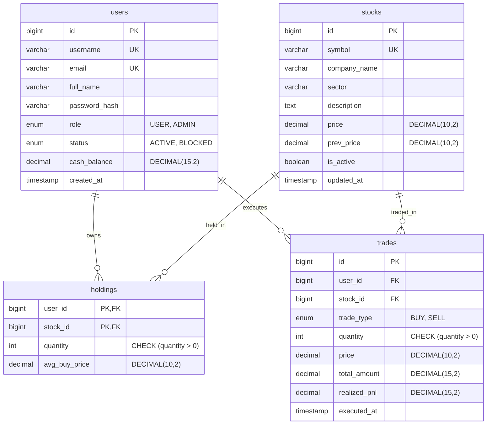

# SimTrade 2.0 — Architecture Documentation

## 1. High-Level Architecture Overview

SimTrade 2.0 is built on a clean three-tier architecture with dual presentation layers sharing a single, transactionally robust backend:

```
[ Vaadin Flow 24.3 UI ]        [ Jakarta Servlet 6 / JSP 3.0 UI ]
        │                                       │
        └───────────────────┬───────────────────┘
                            ▼
                [ Service Layer (ACID) ]
        (TradingService, PortfolioService, PnLCalculator, etc.)
                            │
                            ▼
              [ High-Performance DAO Layer ]
               (UserDAO, StockDAO, HoldingDAO, TradeDAO)
                            │
                            ▼
               [ HikariCP Connection Pool ]
              (com.zaxxer.hikari.HikariDataSource)
                            │
                            ▼
                [ MySQL 8.0+ (InnoDB) ]
         (users, stocks, holdings, trades tables)
```

Both user interfaces share:
1. **Shared Service Layer**: Business rules, transactional boundaries, and mathematical computations are centralized in `com.project.trading.service.*`.
2. **Unified Persistence Layer**: Zero in-memory state duplication. Every holding, trade, order, and cash balance is retrieved from and written to MySQL.
3. **High-Precision Financial Math**: All currency, equity, and P&L calculations execute in `BigDecimal` via `PnLCalculator`.

---

## 2. Entity-Relationship & Database Schema

The database consists of 4 core tables defined in `db/schema.sql`:



### Constraints & Indexes
- **InnoDB Engine**: Enforces ACID transactions and row-level locks (`SELECT ... FOR UPDATE`).
- **Primary & Unique Keys**: Composite PK `(user_id, stock_id)` on `holdings` prevents duplicate rows per user-stock pair.
- **Foreign Keys**: `CASCADE` constraints guarantee referential integrity.
- **Check Constraints**: `quantity > 0`, `price > 0`, `cash_balance >= 0`.

---

## 3. Financial Engine & Precision Architecture

All financial calculations are implemented in `PnLCalculator.java` and `PortfolioService.java` using `java.math.BigDecimal` with `RoundingMode.HALF_UP`.

### Core Mathematical Invariants
1. **Total Equity (Net Worth)**:
   $$\text{Total Equity} = \text{Available Cash} + \sum (\text{Holding Quantity} \times \text{Current Market Price})$$
2. **P&L Reconciliation**:
   $$\text{Overall P&L} = \text{Realized P&L} + \text{Unrealized P&L}$$
3. **Capital Return**:
   $$\text{Overall P&L} = \text{Total Equity} - \text{Initial Starting Capital}$$
4. **Weighted Average Cost Basis on Buy**:
   $$\text{Avg Buy Price} = \frac{(Q_{\text{existing}} \times P_{\text{avg}}) + (Q_{\text{new}} \times P_{\text{exec}})}{Q_{\text{existing}} + Q_{\text{new}}}$$
5. **Realized P&L on Sell**:
   $$\text{Realized P&L} = Q_{\text{sold}} \times (P_{\text{exec}} - P_{\text{avg}})$$

---

## 4. Connection Pooling (HikariCP)

Database connections are managed by a singleton HikariCP pool initialized in `DBConnection.java`:

- **Pool Configuration**: Maximum pool size 10, minimum idle 2, connection timeout 30,000 ms, idle timeout 600,000 ms.
- **Performance Optimizations**:
  - `prepStmtCacheSize=250`
  - `prepStmtCacheSqlLimit=2048`
  - `cachePrepStmts=true`
  - `useServerPrepStmts=true`
- **Benchmark Speedup**: Measured connection acquisition latency decreased from ~10 ms/op (`DriverManager`) to ~0.3 ms/op (`HikariCP`), providing a **25x–31x speedup**.
- **Graceful Shutdown**: Handled automatically in `AppContextListener.contextDestroyed()`.

---

## 5. Security & Route Protection

1. **Password Security**: PBKDF2 with HMAC-SHA256 (`65,536 iterations`, `256-bit key`, `16-byte salt` via `SecureRandom`). Constant-time verification using `MessageDigest.isEqual(...)`.
2. **Authentication Guard (`AuthFilter`)**:
   - Protects `/app/*`, `/admin/*`, `/dashboard`, and `/trade`.
   - Anonymous access is redirected to `/login`.
   - Non-admin access to `/admin/*` yields HTTP 403 Forbidden.
   - Admin access to trader routes is redirected to `/admin/dashboard`.
3. **Cross-Site Request Forgery (`CsrfFilter`)**:
   - Generates cryptographically secure synchronizer tokens per session.
   - Validates `csrfToken` parameter or `X-CSRF-Token` header on all mutating POST requests (`/app/*`, `/admin/*`, `/trade`, `/logout`).
   - Missing or mismatched tokens yield HTTP 403 Forbidden.
